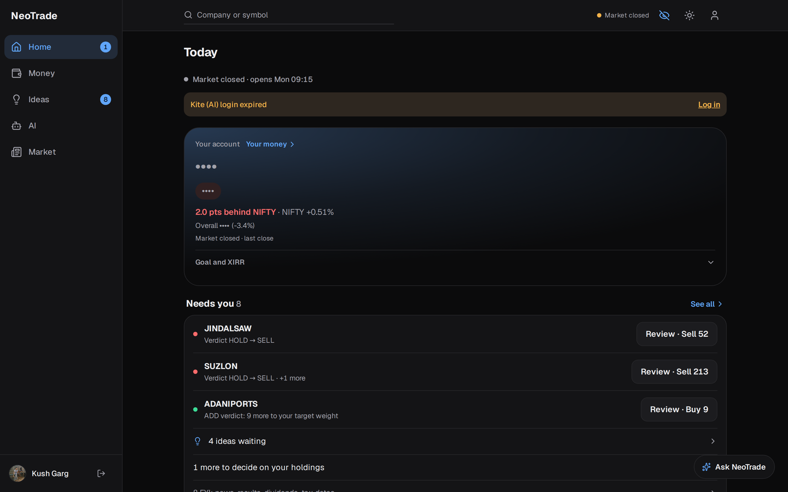
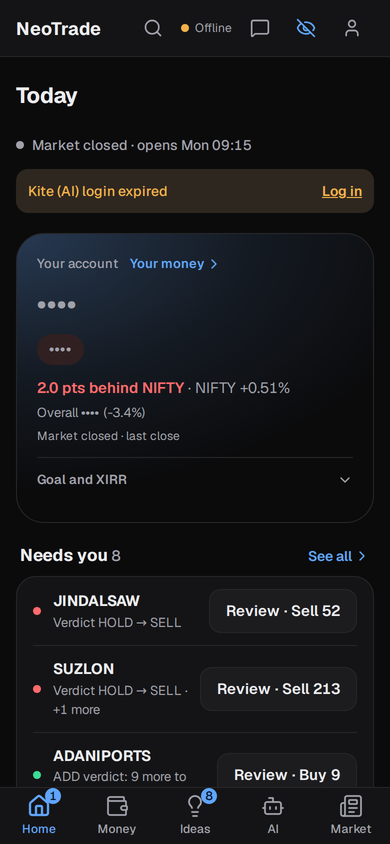
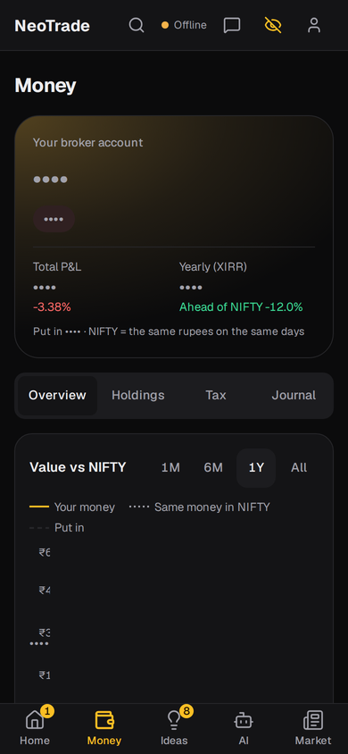
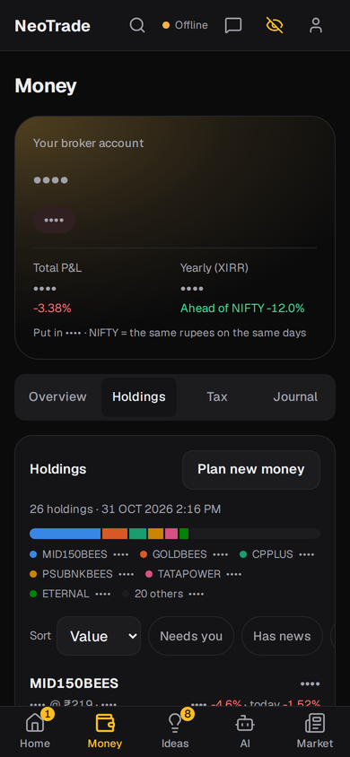
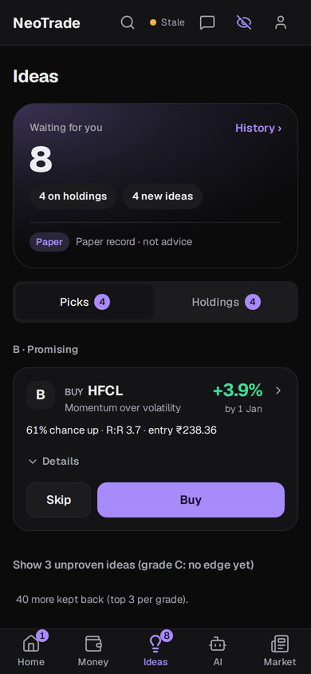
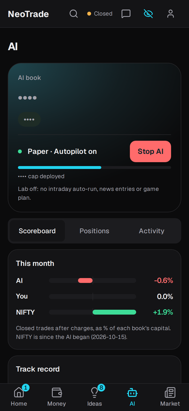
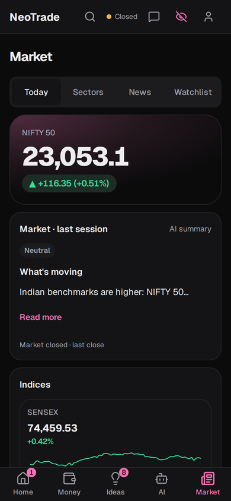
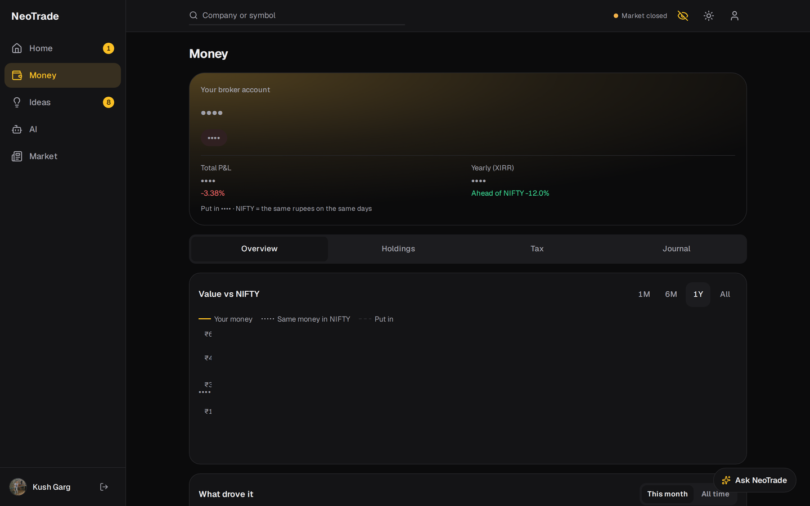
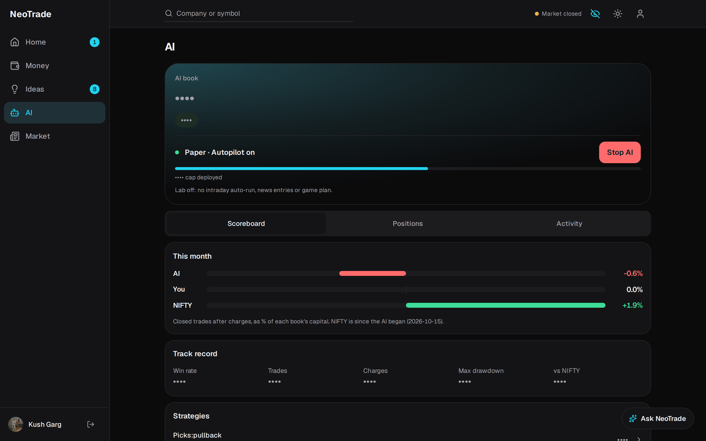
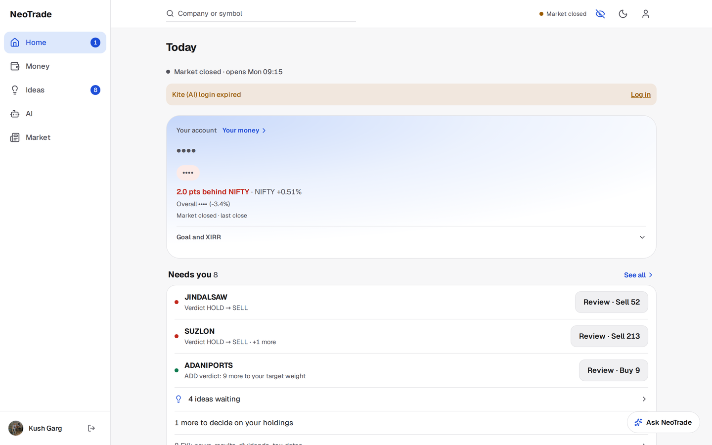

# NeoTrade

**Live app:** [neotrade-trading.vercel.app](https://neotrade-trading.vercel.app) (Google sign-in) ·
**API:** [neotrade.161.118.167.148.nip.io](https://neotrade.161.118.167.148.nip.io/health) ·
**API docs:** [Swagger](https://neotrade.161.118.167.148.nip.io/api/v1/docs) / [ReDoc](https://neotrade.161.118.167.148.nip.io/api/v1/redoc)



A trading workstation for Indian equities, built on top of the trader's own broker
(Zerodha Kite, Upstox, Angel One). It runs **two broker accounts side by side**:

- **Your account.** NeoTrade reads your holdings every day and tells you where you stand,
  what moved and why. It journals every trade, tracks tax lots, and enforces the loss limits
  you set. It never trades this account on its own: every order is your two-tap decision.
- **The AI account.** A second account the app runs itself: a rule strategy engine, a
  long-term scan, news and an autopilot. It trades **on paper until a strategy earns real
  money** (a passing backtest plus a passing paper record), then on capped capital.

An idea reaches your account only from a strategy that proved itself on the AI account. The
two accounts compete, net of charges, on the Today screen.

The defining constraint: **the AI's share of any trade's conviction is capped at 30%, and it
cannot rescue a trade the rules did not already support.** The cap is enforced in a frozen
dataclass and covered by tests (`backend/scoring/composite.py`), not left to convention.

> Screenshots are from the live deployment with "hide amounts" switched on, so rupee figures
> show as `••••`.

## Screenshots

Phone is the design target: short glances during market hours.

| Today | Money | Holdings | Ideas | AI | Market |
|---|---|---|---|---|---|
|  |  |  |  |  |  |

Desktop, plus the light theme:

| Money | AI account | Today (light) |
|---|---|---|
|  |  |  |

## Features

- **Today.** The first screen of the day: market and broker-session status, your account
  against NIFTY, a ranked **Needs you** list (verdict changes, exit levels, proven ideas,
  guardrail alerts), an after-the-close summary of what moved your money, and the AI
  account's last moves with a Stop button. The same answer goes to Telegram at 08:45 and after
  the close.
- **Money (your account).** Value, total P&L and XIRR against NIFTY on the same cash flows;
  holdings merged across brokers by ISIN; Indian FY capital-gains tax by FIFO lot, with
  harvesting hints; and a per-stock page with your thesis, target and stop alerts.
- **Journal and guardrails.** Every broker trade auto-imported (equity, options, futures) into
  a P&L calendar with notes and setup tags; behaviour findings over your own history; daily
  loss limit, trade-count and cooldown guardrails that also trip the engine's kill switch.
- **Ideas (Picks).** A daily picks engine grades setups (A/B/C) with chance-up, reward:risk,
  entry, stop and target, and scores every decision on a forward record before it is trusted.
  Admin-only: it reads as advice, and NeoTrade is not a SEBI Research Analyst.
- **AI account and autopilot.** Rule strategies (intraday and long-term) emit fully-formed
  trades: size, entry, stop, target, the rule codes that fired, and a composite score. The
  autopilot trades only the AI-role broker, behind a fence and the daily loss kill switch.
- **Risk-aware sizing.** Position size comes from account size, per-trade risk and stop
  distance, with exposure limits. It is never computed inside a strategy.
- **Backtesting and the Lab.** Strategies replay through the same runner and execution
  simulator used live, with Indian transaction costs modelled. Runs, forward scorecards and
  the options chain live in the admin Lab.
- **Market.** Indices, sectors, Nifty 200 breadth, movers, news with AI summaries, and a
  watchlist.
- **Ask NeoTrade.** A chat assistant on every page that answers from your own data. Any
  change it prepares (an order, a limit) is a card that does nothing until you confirm it.
- **Live data with honest states.** Prices arrive over WebSocket with explicit live / stale /
  market-closed states, and a hide-amounts switch for when someone can see your screen.

## Documentation

| Question | Document |
|---|---|
| What is this product, who uses it, what states matter? | [`PRODUCT.md`](PRODUCT.md) |
| Where is X, what calls Y? | [`docs/wiki/INDEX.md`](docs/wiki/INDEX.md) |
| How does the code work? | [`frontend/src/handbook/`](frontend/src/handbook/) (also in the app, admin-only) |
| What gets built next? | [`docs/ROADMAP.md`](docs/ROADMAP.md) |
| Visual system | [`DESIGN.md`](DESIGN.md) |

## Tech stack

**Backend.** FastAPI on Python 3.11, MongoDB (motor) on Atlas plus a local Mongo container for
bulky market history, Redis, pandas/numpy for indicators, broker adapters for Kite, Upstox and
Angel One, and pytest. Every LLM call goes through a self-hosted
[OmniRoute](https://github.com/diegosouzapw/OmniRoute) gateway; prompts live in
`backend/prompts/*.md`.

**Frontend.** React 19 and Vite (plain JSX), Tailwind v4, React Router 7, recharts,
lucide-react, axios, Google sign-in.

**Infrastructure.** Docker Compose on an Oracle Cloud VM behind Nginx and Let's Encrypt for
the backend; Vercel for the frontend. Both are push-to-deploy from `main`: the backend through
a self-hosted GitHub Actions runner gated on CI, the frontend through Vercel's git integration.

## Setup

### Docker (recommended)

```bash
git clone https://github.com/kushgarg132/NeoTrade.git
cd NeoTrade
# create .env with the values below, then:
docker compose up -d --build backend ingest jobs mongo
```

Compose runs four services:

| Service | What it does |
|---|---|
| `backend` | The FastAPI app (API + WebSocket), port 8000 |
| `ingest` | Market, macro and news data worker (`backend.datalayer.worker`) |
| `jobs` | Scheduled jobs: picks, reviews, reports, the 16:00 reconciliation (`backend.jobs`) |
| `mongo` | Local MongoDB for daily bars and news history |

Required in `.env`: `MONGODB_URL`, `LOCAL_MONGODB_URL`, `REDIS_URL`, `GOOGLE_CLIENT_ID`,
`JWT_SECRET`, `CREDENTIAL_ENCRYPTION_KEY`, `CORS_ALLOWED_ORIGINS`, `ADMIN_EMAILS`.
For anything using the LLM: `OMNIROUTE_BASE_URL` and `OMNIROUTE_API_KEYS`.
Optional: `TELEGRAM_BOT_TOKEN`. Broker credentials are entered per user in Settings, and an
unconnected broker is a normal state, not an error.

### Manual

```bash
# backend (needs Mongo and Redis reachable)
python -m venv .venv && source .venv/bin/activate
pip install -r backend/requirements.txt
uvicorn backend.server:app --reload --port 8000

# frontend
cd frontend
npm install
npm run dev
```

### Tests

```bash
python -m pytest            # backend
cd frontend && npm test && npm run build   # frontend: node --test, then a real build
```

## Project structure

```
backend/
├── strategies/   # rule strategies (intraday, longterm) + registry
├── scoring/      # composite score, AI cap, rule floor
├── engine/       # runner, sizing, portfolio, execution, backtest
├── autopilot/    # AI-account autopilot and its fence
├── brokers/      # Kite, Upstox, Angel One adapters; account roles
├── journal/      # trade journal, behaviour findings
├── guardrails/   # user-set limits
├── risk/         # kill switch, backtest and paper gates
├── portfolio/    # holdings, verdicts, tax lots
├── datalayer/    # shared market/news data (the ingest worker)
├── ai/, chat/    # fact layer, tool runner, assistant
├── prompts/      # every LLM prompt, as markdown
├── routers/      # FastAPI endpoints
└── tests/

frontend/src/
├── pages/        # Home (Today), Money, Ideas, Ai, Market, Stock, Settings, Lab
├── components/   # layout + UI
├── handbook/     # the code handbook, rendered in the app
└── hooks/, utils/
```

## Not advice

NeoTrade is a personal tool. It is not a broker, holds no funds, and does not recommend trades
to anyone for a fee. Recommending trades for money in India needs SEBI Research Analyst
registration, which this project does not have.
